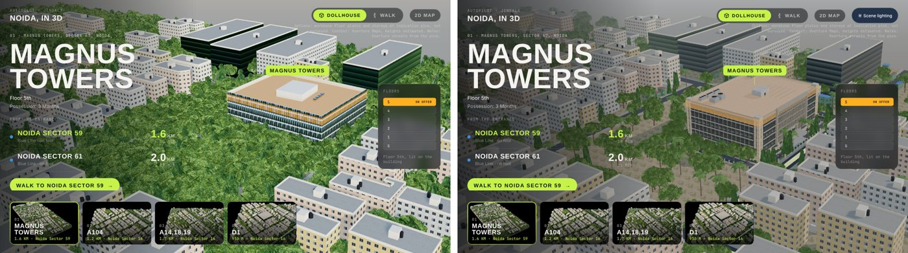
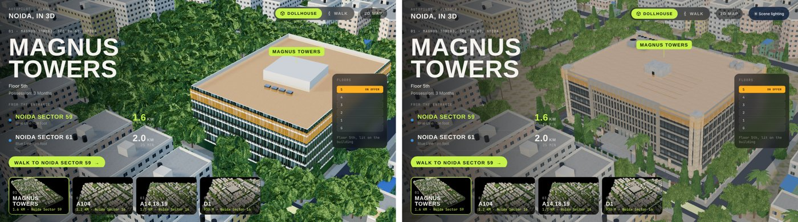
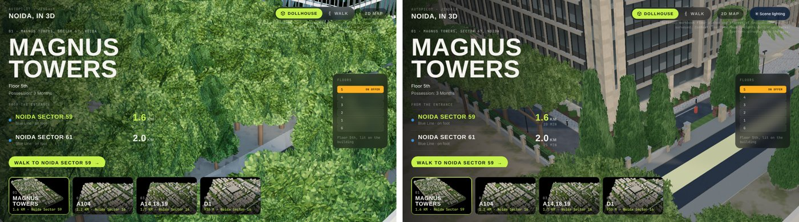
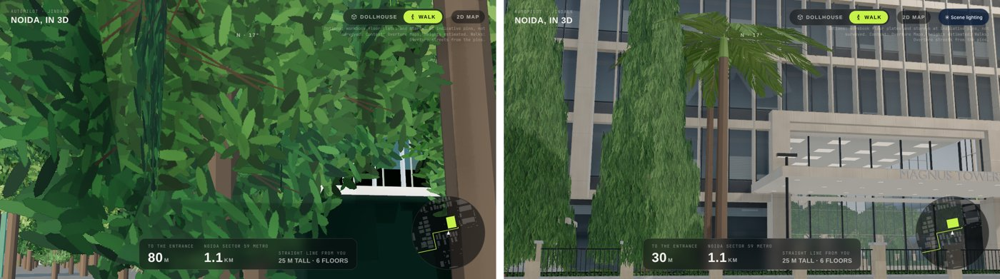
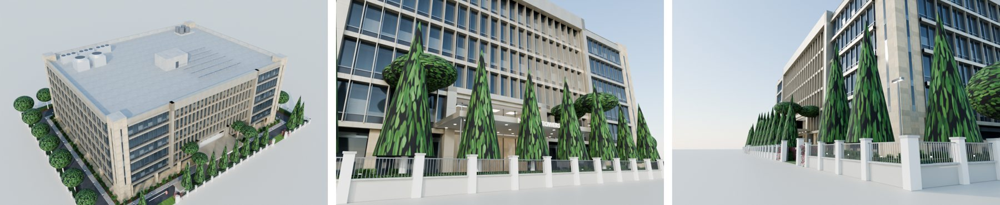
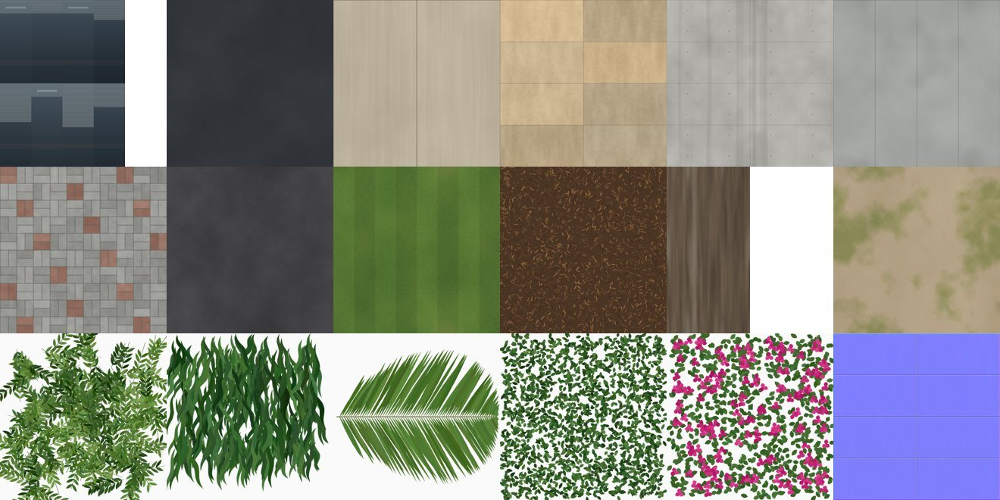

# Visual realism report: JindalX 3D explorer

`/jindalx-noida/world`, branch `update-jindal-dev`, 23 November 2026. This follows
`VISUAL_REALISM_AUDIT.md` (phase 1). The pilot is Magnus Towers, and it is now done. The context
upgrade (trees, ground, light) covers all four JindalX options, because they share one pipeline.

## In short

- **Magnus Towers is now a modelled building on a planned site**, not a highlighted box. It has a
  stone colonnade, a double-height glazed entrance under a canopy, a curtain wall with mullions and
  spandrels, fins, stone corner cores, a parapet, rooftop plant, and a full plot (boundary wall,
  gates, guard cabin, forecourt, drive, parking, ramp, lawns, hedges, trees, lights).
- **The tree carpet is gone from every option.** Trees now line the roads as avenues, fill the
  parks, and are thin elsewhere. They use three new species models with new leaf textures.
- **Open ground has a real material** (dry soil with patchy grass) instead of tinted roof texture.
- **Lighting is photographic.** AgX tone mapping, and the time-of-day studio (morning, midday,
  golden hour) is switched on for JindalX.
- **It is faster, not slower.**
  - Frames are 3.5 to 7.8 times quicker, because the scene draws 37 to 72 percent fewer triangles.
  - The download is larger (new textures), but the first frame arrives sooner.
- **Every mode still works:** dollhouse, walk, 2D map, option switching, floors, distances, routes,
  quality tiers. The smoke test passes 19 of 19 and the unit tests pass 79 of 79.

## Before and after, from identical cameras

Each pair below is the same camera position, target and field of view, in the real app, on the old
build (left, commit `d178278`) and the new one (right). `scripts/world-compare.cjs` sets each
camera through the `?perf=1` hook, so nothing moves between shots.

**Regional view.** The tree carpet is replaced by avenues and a sparse scatter, so streets, plots
and building bases are readable. Magnus Towers reads as architecture from 600 m.

**Property view.** Colonnade, curtain wall, fins, stone cores, parapet, rooftop plant, the
landscaped plot with palms at the forecourt, and the drive.

**Landscape view.** Boundary wall with railing and stone pillars, ashoka trees along the front,
bollards, pole lights, the pavement and the road. The old view at this spot was solid canopy.

**Street view (walk mode).** The old walk start stood inside a tree. The new one starts on the
pavement facing the entrance: canopy with downlights, the "MAGNUS TOWERS" fascia, the lobby, palms.

**Blender previews** of the building model on its own (aerial, entrance, street). The cone trees
here are stand-ins used only in this preview; in the app they are replaced by the real species.

**Texture library** (colour maps; each also has a roughness and a normal map). Top: glass with
interior, spandrel glass, champagne aluminium, sandstone, concrete, roof membrane. Middle: pavers,
asphalt, lawn, mulch, bark, Noida open ground. Bottom: neem, ashoka, palm, shrub and bougainvillea
leaf cards, and one normal map.

## What changed

### System B: the property showcase (Magnus Towers)

`scripts/world/magnus_hero.py` builds the building and its site in Blender (headless `bpy`) and
writes a GLB plus a site file. `diorama.py --exterior ... --site ...` puts both into the option's
diorama: it drops the map trees and street lamps that fall inside the plot, uses the plot's trees
instead, and moves the entrance marker and the walk start to the new forecourt and pavement.

| Element | What is modelled |
| --- | --- |
| Ground floor | Stone-clad columns, recessed glazing behind them, a 12 m wide, 9 m tall glazed portal with a lit lobby behind it, and a 7 m by 16 m cantilevered canopy with downlights and the building name on its fascia |
| Floors 1 to 5 | Unitised curtain wall: mullions every 1.5 m, transoms, spandrel glass at each slab, projecting aluminium slab bands |
| Road face | A framed bay with vertical fins |
| Sides | Fins on the east and west faces; stone-clad corner cores |
| Roof | Parapet with coping, lift machine room, three chillers, two cooling towers, four water tanks, a solar array |
| Plot | Boundary wall with railing and stone pillars, two gates, a guard cabin with a boom barrier, a paved forecourt and drop-off, an asphalt drive, marked parallel parking, a covered basement ramp, lawns, mulch beds, kerbs, hedges, shrubs, bougainvillea, pole and bollard lights |
| Trees on the plot | Ashoka every 4.5 m along the front boundary (open on the entrance axis), neem every 9 m on the other sides, four palms at the forecourt |

The model is about 46,800 triangles with 26 materials. It replaces a box that carried one facade
texture on all four sides.

### System A: the context (all four options)

- **Tree models** (`protos()` in `diorama.py`).
  - Each crown is built from branch clusters of leaf cards on a real trunk and limbs.
  - Neem: a broad, open, rounded crown.
  - Ashoka: a tall, narrow column with drooping leaves.
  - Palm: a crownshaft with cut-out frond cards.
  - Each tree also gets its own height and width at load (`m4t` in `world.js`), so no two neighbours
    match.
- **Tree placement** (`prep.py`, region files). Options in `scripts/world/regions/noida-jindalx-*.json`:
  - avenue trees every 11 m along main roads, set 2.6 m outside the carriageway;
  - roadside density 0.55 and open-ground density 0.3, where both used to be dense;
  - parks are still dense.

  Tree counts:

  | Option | Before | After |
  | --- | --- | --- |
  | A14/18/19 | 20,358 | 7,926 |
  | Magnus Towers | 15,733 | 5,468 |
  | A104 | 9,171 | 3,559 |
  | D1 | 6,493 | 2,536 |
- **Ground.** `ground_noida`: dry Noida soil with patches of grass, colour, roughness and normal.
  It is set per atlas (`groundTex` in `jindalx/build-data.cjs`), so Andheri keeps its own.
- **Light.**
  - AgX tone mapping (`tone: "agx"`), which keeps foliage green where ACES pushed it to orange.
  - The time-of-day studio (`engine/andheri-scene-lighting.js`) is enabled for JindalX.
    - It has morning, midday and golden hour presets.
    - It works out the real sun position for the site, date and hour.
    - The sky, reflections, fog and sun change with it.
  - The studio takes an exposure offset (`ev`), set to -0.35 for JindalX.
  - The shadow box widens to 420 m when the studio is on.
  - No bloom was added.

### Materials

`scripts/world/hero_textures.py` generates every texture. Each one is tileable and comes with
colour, roughness and normal maps at a real-world scale (glass 6 m by 8 m, panels 2.4 m, pavers 2 m).
`engine/world.js` reads them by material name:

- `HERO` sets metalness, normal strength and reflection strength per material;
- `HERO_FLAT` covers small untextured parts (mullions, plant, solar panels, railings);
- glass and spandrel use the reflection probe;
- lobby glass is see-through.

The glass carries a painted interior (ceiling lights, blinds), so it reads as an occupied floor
rather than a mirror. Its reflection was turned down after the first comparison: at 0.45 metalness
it washed out to sky colour when seen head-on, which real glazing does not do.

## Performance validation

Measured with `scripts/world-bench.cjs` (see `PERFORMANCE_REPORT.md` for the method). Same container,
same viewport (960×540, pixel ratio 1), same cameras, old build at `d178278` against the new one.
The container has no GPU, so Chromium renders with SwiftShader on the CPU:

- triangles, draw calls, textures, bytes and requests are exact;
- frame times are only meaningful as before-and-after ratios.

### Magnus Towers

| | Before | After | Change |
| --- | --- | --- | --- |
| Triangles, dollhouse still | 1.57 M | 1.00 M | -37% |
| Triangles, walk | 3.58 M | 1.00 M | -72% |
| Draw calls, dollhouse still | 166 | 196 | +30 |
| Draw calls, walk | 232 | 181 | -51 |
| Frame, dollhouse still (SwiftShader) | 7.92 s | 2.22 s | 3.6× faster |
| Frame, dollhouse orbiting | 7.83 s | 2.13 s | 3.7× faster |
| Frame, walking | 23.5 s | 3.03 s | 7.8× faster |
| Textures in memory | 59 | 93 | +34 |
| JS heap | 53 MB | 49 MB | -4 MB |
| Download, first visit | 7.7 MB | MAGNUS_WIRE | MAGNUS_DELTA |
| Page ready (UI interactive) | 1.18 s | 1.82 s | +0.6 s |
| First 3D frame | 27.5 s | 11.2 s | 2.5× sooner |

### A14/18/19 (the heaviest option, context changes only)

| | Before | After | Change |
| --- | --- | --- | --- |
| Triangles, dollhouse still | 2.35 M | 1.46 M | -38% |
| Triangles, walk | 1.36 M | 1.10 M | -19% |
| Draw calls, dollhouse still | 180 | 156 | -24 |
| Frame, dollhouse still | 7.35 s | 2.42 s | 3.0× faster |
| Frame, dollhouse orbiting | 13.6 s | 2.51 s | 5.4× faster |
| Frame, walking | 18.3 s | 2.16 s | 8.5× faster |
| Textures in memory | 67 | 72 | +5 |
| JS heap | 61 MB | 52 MB | -9 MB |
| Download, first visit | 10.5 MB | A14_WIRE | A14_DELTA |
| First 3D frame | 20.5 s | 12.4 s | 1.7× sooner |

### Where the cost went, and why it is accepted

- **Faster frames.** The tree thinning removed far more than the building and its site added.
  Magnus's hero adds about 47 k triangles, which is under 5 percent of a frame.
- **30 more draw calls on Magnus in the dollhouse.** The hero has 26 materials, and its plot
  elements are separate meshes. Investigated: it is the hero alone (A14, which has no hero, went down
  by 24). 196 calls is well within budget and frames are 3.6 times faster all the same. Merging the
  hero by material in Blender would cut it further; see "Next steps".
- **34 more textures and a larger first download.**
  - The new PBR sets (colour, roughness and normal for 12 surfaces, plus 5 leaf atlases) are new
    bytes.
  - To contain them, normal and roughness maps are saved at JPEG quality 82 and 80, and the leaf
    atlases as 256-colour PNGs with alpha. That took the new textures from 4.6 MB to 2.3 MB with no
    visible change (checked in the landscape view).
  - All textures are cached for a year (`vercel.json`), so this is a first-visit cost only.
- **Page ready is 0.6 s later** on Magnus. It is the bigger GLB (the hero and its site). The
  first 3D frame still comes 16 s sooner on this machine, because there is so much less to draw.
- **The performance work is kept.** Forest cells and levels of detail, instancing, static shadows,
  render on demand, adaptive quality tiers, prefetch and caching are all unchanged. The new trees
  go through the same `buildForest`.

## Functionality check

- **`scripts/world-smoke.cjs`, 19 of 19 passed.** It covers load, dollhouse, walk, 2D map, option
  switching to every option, all four quality tiers, and no page errors.
- **`npm test`, 79 of 79 passed.**
- **Logic gate (`diorama.py`), passes on all four options.** Nothing is in a road, nothing overlaps,
  and the entrance faces a road.
- **The Blender option renders** (`media/jindalx-noida/world/r/*-hero.jpg` and `*-street.jpg`, used
  as the option cards and the first-paint image) were re-rendered from the new models.

## What was assumed, and what was not invented

- **The architecture is a neutral Grade A office design, not the architect's.**
  - Known, and used: B+G+5 storeys and 38,000 sq ft a floor (client workbook), and glazing on the
    building (a public glass and glazing contract for this plot).
  - Everything else is a plausible design for a new Noida office building: the colonnade, curtain
    wall, fins, stone, canopy and rooftop plant. It is labelled as such in `magnus_hero.py`.
  - Swap in the real design when the developer's renders or drawings are available.
- **The plot layout is typical, not surveyed.** That covers the gates, guard cabin, drive, parking,
  ramp and planting. The building position is still the indicative massing from
  `plot_massing.py`, now set back 12 m from the road and kept 10 m clear of the side road.
- **No amenities were invented.** No pool, clubhouse, courts, water features or cafeteria (the
  workbook says a cafeteria is only "planned").
- **Tree species are generic North Indian street trees** (neem, ashoka, palms), not a survey of the
  actual trees.

## What was not done, and why

- **KTX2 texture compression.** No KTX2 encoder (toktx or basisu) can be installed in this
  container. The textures are tight JPEG and palette PNG instead. KTX2 would also cut GPU memory,
  and is the first thing to do on a machine with the toolchain.
- **Scanned CC0 materials and models** (Poly Haven, ambientCG). These sites are blocked from this
  container. Every texture and tree is generated by scripts in the repository, so there are no
  third-party licences to track.
- **Blender MCP.** Not connected in this session. Blender ran as the `bpy` module, headless, the
  way the existing pipeline does.
- **Real-device FPS.** As with the performance report, real frame rates on a laptop or phone have
  not been measured here. The ratios above should carry over.

## Next steps

1. **Phase 6: the other three options.** A104, A14/18/19 and D1 already have the new context. They
   still use the generic option building. The same approach applies: a `*_hero.py` per building,
   from its workbook floor plate and storeys, through `--exterior` and `--site`. Most of
   `magnus_hero.py` (facade system, roof plant, plot kit) can become a shared module first.
2. **Merge the hero by material** in Blender before export, to bring Magnus's draw calls back
   under the old figure.
3. **KTX2** on a machine with `toktx`.
4. **Replace the assumed architecture** with the developer's design once it is in hand.

## Files

| File | What it is |
| --- | --- |
| `VISUAL_REALISM_AUDIT.md` | Phase 1 audit |
| `VISUAL_REALISM_REPORT.md` | This report |
| `scripts/world/magnus_hero.py` | Magnus Towers building and site model (new) |
| `scripts/world/hero_textures.py` | Texture and leaf-atlas generator (new) |
| `scripts/world/diorama.py` | `--site` support, new tree models, palm leaf material |
| `scripts/world/prep.py`, `regions/noida-jindalx-*.json` | Avenue planting and densities |
| `scripts/world/plot_massing.py`, `refs/noida_jindalx.json` | Explicit setback and road clearance; Magnus outline |
| `engine/world.js` | Hero materials, leaf-card mapping, per-tree variation, AgX, studio for any atlas, glass tuning |
| `engine/andheri-scene-lighting.js` | Exposure offset |
| `jindalx/build-data.cjs`, `engine/atlases/jindalx-noida.js` | Ground texture, tone mapping, lighting settings |
| `media/jindalx-noida/world/d/*` | Rebuilt dioramas |
| `media/jindalx-noida/world/tex/*` | New textures |
| `media/jindalx-noida/world/r/*` | Re-rendered option stills |
| `docs/visual-realism/*` | Comparison images |
